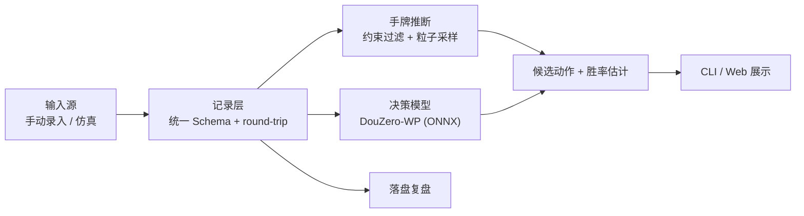

# doudizhu · 斗地主决策助手

> 给定一个牌局局面，推断另外两家手上还有什么牌，给出候选出牌及各自的胜率估计，并把整局完整落盘供复盘。

**项目状态：端到端最小闭环已跑通** —— 一个局面进，带候选建议的记录出。工作项与依赖关系见 [Issues](https://github.com/nicknicka/doudizhu/issues)，设计见 [docs/design.md](docs/design.md)。

---

## 要解决的问题

斗地主是**不完美信息**的多人博弈。轮到你出牌时，你能确定的只有三样：自己的手牌、已经打出的牌、地主的三张底牌。另外两家手上还有什么，只能猜。

所以"我这手出得对不对"这个问题难回答，难点不在牌理，而在于**信息本来就不完整**。

这个项目把"不完整"显式建模成一份**概率分布**，而不是凭感觉：

1. **推断** —— 约束过滤 + 粒子采样，输出另外两家手牌的一个可信分布
2. **评估** —— DouZero 模型为候选出牌打分，给出胜率差异
3. **复盘** —— 每局完整落盘，可回放、可对照、可统计

## 难点在哪

- **不完美信息**：对手手牌未知，无法搜索出一个"正确答案"，只能给概率
- **协作博弈**：两个农民是队友，目标函数不是零和
- **动作空间巨大**：合法出牌组合约 10^4 量级
- **没有可用的现成评测**：要证明"推断得准"，得自己造带真值的局面

## 系统概览



## 技术选型

| 层 | 选择 | 理由 |
|---|---|---|
| 语言 | Python 3.11 | RLCard / DouZero 生态 |
| 推理 | ONNX Runtime（CPU） | 权重有 ONNX 版本，无需 PyTorch，省磁盘、启动快 |
| 仿真与真值 | RLCard | 环境内部持有全部玩家真实手牌，可作评测真值 |
| 决策模型 | DouZero-WP（预训练） | 按胜负目标训练，语义比 ADP 版本更贴近"胜率" |
| 推断 | 约束过滤 + 粒子采样 | 零训练，每条结论可解释 |
| 后端 | FastAPI | — |

**不训练任何模型**：DouZero 由自我博弈训练而成，人类对局数据非必需。

## 快速开始

```bash
python3.11 -m venv .venv
.venv/bin/python -m pip install --no-cache-dir -r requirements.lock.txt
.venv/bin/python -m pip install --no-cache-dir -e . --no-deps
.venv/bin/python scripts/download_models.py   # 约 18 MB 的 ONNX 权重
.venv/bin/python -m pytest
```

预期结果：`198 passed`（未下载权重时相关用例会跳过）。

依赖是从 `requirements.lock.txt` 装的，含间接依赖的完整锁定；有一条测试专门比对已装版本与清单，浮动就会失败。

### 给出建议

```bash
.venv/bin/python -m ddz suggest \
    --in  tests/data/position_landlord_up.json \
    --out /tmp/advice.json
```

```
局面：landlord_up 行动，手牌 17 张，合法动作 2 个
  1. 222            估计 +0.4587
  2. 不出            估计 +0.4582
  （模型给出的估计，不是真实胜率）
```

输入是一个局面记录，输出是同一记录**追加了 `advice` 段**。同一局面重跑，输出逐字节相同。

### 录一局真实牌局

```bash
# 1. 录入开局：我方手牌 + 三张底牌 + 我的位置
ddz new --me landlord_up --hand 34556789TTJJKK222 --landlord-cards 792 --out game.json

# 2. 逐手录，每步都会校验轮次与合法性；录完轮到我方时可以直接要建议
ddz play --in game.json --out game.json --player landlord --cards 55 --suggest
ddz play --in game.json --out game.json --player landlord_down --pass

# 3. 录错了撤掉最后一手；也可以截断到第 N 手从那儿继续
ddz undo --in game.json --out game.json
ddz show --in game.json --suggest

# 4. 回放：只凭记录文件跳回任意一个决策点（0 = 开局）
ddz show --in game.json --step 0
```

每一步都校验：轮次对不对、牌型认不认得、牌有没有出过、压不压得住。录不进去就直接报错，
所以不会攒出一局规则上不成立的牌。

### 产评测数据

```bash
# 一局产出三条记录（三家各一个视角），每条都带三家的真实开局手牌
ddz simulate --games 50 --seed 0 --out-dir data/sim
```

`--seed` 相同就产出同一批（逐字节相同）。这批数据是后续评测真值的唯一来源：
每个决策点的真实手牌由「开局手牌 − 已出的牌」推出来，不需要逐步另存。
`data/` 不进 Git 历史。

**限制**：必须从开局录起。牌池是「全牌 − 我方手牌 − 已出的牌」推出来的，
不录前史就会算出一个偏大的池子，模型会收到错的输入。要支持"中途冷启动"需要扩展
Schema（显式存入此前各家的出牌），见 [docs/data-schema.md](docs/data-schema.md)。

依赖版本与踩过的坑都记在 [docs/environment.md](docs/environment.md)，包括 RLCard 1.2.0 的动作接口差异、仿真器观测里的信息泄漏，以及模型特征对推断的依赖。

## 目录结构

```
.
├── docs/                     设计文档
│   ├── design.md             设计共识（定稿）
│   ├── architecture.md       架构与接口契约
│   ├── data-schema.md        记录格式与 round-trip 约定
│   ├── environment.md        环境、依赖版本与实测发现
│   ├── rules.md              规则核对结果与信息泄漏记录
│   └── roadmap.md            阶段计划与验收标准
├── src/ddz/
│   ├── source/               输入源适配器
│   ├── record/               记录层：Schema、读写、回放
│   ├── policy/               决策模型封装（ONNX）
│   ├── inference/            手牌推断
│   ├── evaluation/           评测：命中率、基线对照
│   └── cli/                  命令行入口
├── tests/                    测试
├── scripts/                  工具脚本（如下载权重）
├── web/                      前端展示
├── models/                   模型权重（本地，不入库）
└── data/                     运行期数据（本地，不入库）
```

## 路线图

| 阶段 | 目标 | 完成判定 |
|---|---|---|
| S0 | 环境跑通：venv + rlcard + onnxruntime + 权重下载 | 环境可复现，规则比对无差异 |
| S1 | CLI：给定局面 → 3 个候选动作 + 胜率估计 | 同一局面重跑结果一致，round-trip 测试通过 |
| S2 | 手牌推断 + 仿真真值评测 | 产出可复现的命中率数字，并与随机基线对照 |
| S3 | Web 展示 + README + 演示录屏 | 外人看完录屏能说清做了什么、难在哪 |

详见 [docs/roadmap.md](docs/roadmap.md)。

## 范围之外

- 不训练模型，不做叫分决策
- 不做 OCR / 屏幕识别 / 平台对接
- **不做线上真人平台的实时辅助**：架构上留位置，但不实现、不发布

## 第三方与许可

本项目使用以下开源成果，许可以各自仓库为准：

- [DouZero](https://github.com/kwai/DouZero)（Apache-2.0）— 决策模型与预训练权重
- [RLCard](https://github.com/datamllab/rlcard)（MIT）— 仿真环境与评测真值
- [权重镜像](https://huggingface.co/palemoky/douzero-baselines)（Apache-2.0）— 免登录直连下载
