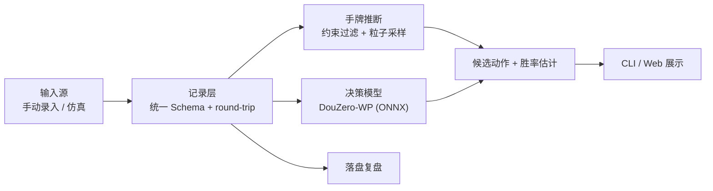

# doudizhu · 斗地主决策助手

> 给定一个牌局局面，推断另外两家手上还有什么牌，给出候选出牌及各自的胜率估计，并把整局完整落盘供复盘。

**项目状态：端到端最小闭环已跑通** —— 一个局面进，带候选建议的记录出。工作项与依赖关系见 [Issues](https://github.com/nicknicka/doudizhu/issues)，设计见 [docs/design.md](docs/design.md)。

---

## 要解决的问题

斗地主是**不完美信息**的多人博弈。轮到你出牌时，你能确定的只有三样：自己的手牌、已经打出的牌、地主的三张底牌。另外两家手上还有什么，只能猜。

所以"我这手出得对不对"这个问题难回答，难点不在牌理，而在于**信息本来就不完整**。

这个项目把"不完整"显式建模成一份**概率分布**，而不是凭感觉：

1. **推断** —— 约束过滤 + 粒子采样，输出另外两家手牌的一个可信分布
2. **评估** —— DouZero 模型为候选出牌打分，给出胜率差异
3. **复盘** —— 每局完整落盘，可回放、可对照、可统计

## 难点在哪

- **不完美信息**：对手手牌未知，无法搜索出一个"正确答案"，只能给概率
- **协作博弈**：两个农民是队友，目标函数不是零和
- **动作空间巨大**：合法出牌组合约 10^4 量级
- **没有可用的现成评测**：要证明"推断得准"，得自己造带真值的局面

## 系统概览



## 技术选型

| 层 | 选择 | 理由 |
|---|---|---|
| 语言 | Python 3.11 | RLCard / DouZero 生态 |
| 推理 | ONNX Runtime（CPU） | 权重有 ONNX 版本，无需 PyTorch，省磁盘、启动快 |
| 仿真与真值 | RLCard | 环境内部持有全部玩家真实手牌，可作评测真值 |
| 决策模型 | DouZero-WP（预训练） | 按胜负目标训练，语义比 ADP 版本更贴近"胜率" |
| 推断 | 约束过滤 + 粒子采样 | 零训练，每条结论可解释 |
| 后端 | FastAPI + uvicorn | 只服务展示页：现算局面、分布、候选与校准，页面自己不含业务逻辑 |

**不训练任何模型**：DouZero 由自我博弈训练而成，人类对局数据非必需。

## 快速开始

```bash
python3.11 -m venv .venv
.venv/bin/python -m pip install --no-cache-dir -r requirements.lock.txt
.venv/bin/python -m pip install --no-cache-dir -e . --no-deps
.venv/bin/python scripts/download_models.py   # 约 18 MB 的 ONNX 权重
.venv/bin/python -m pytest
```

预期结果：`317 passed`（未下载权重时相关用例会跳过）。

依赖是从 `requirements.lock.txt` 装的，含间接依赖的完整锁定；有一条测试专门比对已装版本与清单，浮动就会失败。

### 看展示页

```bash
ddz serve            # 起本机后端，默认 127.0.0.1:8000（--host / --port 可改）
```

打开 <http://127.0.0.1:8000/> 即可。页面上能看到：某个决策点的局面、候选动作与
模型估计、另两家手牌的**粒子云**与逐张概率、以及模型的校准表。

- **直接在网页上录一局**：选我方位置，然后用**牌盘**把手上和底牌点出来（不用记
  `T`/`B`/`R` 那套写法），点「开局」；之后逐手录 —— 牌表上标着现在该谁出，
  轮到你我方时还能直接**点候选项**把这一手记下来（模型已经给所有合法动作排好了序）。
  录错点「撤销」，要留档点「导出 JSON」。
  校验与 `ddz new` / `ddz play` **完全相同** —— 走的是同一段代码（`source/manual.py`），
  所以网页录出来的 JSON 和命令行录出来的可以互相接续。
- **牌桌**：三个座位一屏 —— 地主在上、下家和上家在下；我的一手是真牌面，
  对手是牌背加张数，各家的已出牌也在位。
- **打开已有记录**：点「打开我的记录」选一份 JSON（也可以直接拖到页面上）。
- **翻看决策点**：点步号，或用 ← / → 键。
- **看某张牌**：把鼠标移到粒子云上，或移到侧栏的概率列表上 —— 两边互相高亮；
  点一下（或 Tab 过去按 Enter）可以"钉住"那张牌。

页面**不含业务逻辑**：所有数字都由后端现算（`derive` / `sample` / `DouZeroPolicy` /
`calibrate`），`web/` 只负责显示。GSAP 已随仓库本地化（`web/vendor/`），断网也能用；
但**页面需要后端**，直接双击 HTML 是打不开数据的。

浏览器端的渲染与交互由 Playwright 验证（需联网装一次）：

```bash
npm i && npm run verify     # 自己起后端、跑真实交互、抓 pageerror
```

### 给出建议

```bash
.venv/bin/python -m ddz suggest \
    --in  tests/data/position_landlord_up.json \
    --out /tmp/advice.json
```

```
局面：landlord_up 行动，手牌 17 张，合法动作 2 个
  1. 222            估计 +0.4587
  2. 不出            估计 +0.4582
  （模型给出的估计，不是真实胜率）
```

输入是一个局面记录，输出是同一记录**追加了 `advice` 段**。同一局面重跑，输出逐字节相同。

### 录一局真实牌局

```bash
# 1. 录入开局：我方手牌 + 三张底牌 + 我的位置
ddz new --me landlord_up --hand 34556789TTJJKK222 --landlord-cards 792 --out game.json

# 2. 逐手录，每步都会校验轮次与合法性；录完轮到我方时可以直接要建议
ddz play --in game.json --out game.json --player landlord --cards 55 --suggest
ddz play --in game.json --out game.json --player landlord_down --pass

# 3. 录错了撤掉最后一手；也可以截断到第 N 手从那儿继续
ddz undo --in game.json --out game.json
ddz show --in game.json --suggest

# 4. 回放：只凭记录文件跳回任意一个决策点（0 = 开局）
ddz show --in game.json --step 0
```

每一步都校验：轮次对不对、牌型认不认得、牌有没有出过、压不压得住。录不进去就直接报错，
所以不会攒出一局规则上不成立的牌。

### 问「这张牌可能在谁手上」

```bash
ddz who --in game.json --card 2
```

```
2：还有 1 张没现身
  landlord       0–1 张   有可能
      · 未现身 1 张，他还有 17 张手牌
  landlord_down  0–1 张   有可能
  landlord_up    0–1 张   有可能
（只用公开信息：牌池与各家剩余张数；不读真值）
```

输出的是**张数区间**而不是是非：上限来自「未现身几张、他还剩几张牌」，
下限来自**鸽笼**——三张 K 未现身而另外两家各只剩 1 张时，剩下那张必然在某家手上。

这里**只用可靠约束**，不做「他没压说明没大牌」这类推断——那在斗地主里不成立，
留着大牌不出是合法策略。

### 校准：模型说 60%，实际真的 60% 吗？

```bash
ddz simulate --games 8 --seed 0 --out-dir data/calib
ddz calibrate --in-dir data/calib --buckets 5 --stride 1
```

> **模型输出是 Q 值（期望回报），不是校准过的胜率。**

实跑结果（8 局 · **每个「轮到我方」的决策点都采** · 498 个样本）：

| 估计值区间 | 样本 | 平均估计 | 实际胜率 | 差 |
|---|---|---|---|---|
| [-1.00, -0.60) | 215 | -0.901 | 0.419 | -1.320 |
| [-0.60, -0.20) | 67 | -0.418 | 0.552 | -0.970 |
| [-0.20, +0.20) | 57 | +0.016 | 0.526 | -0.510 |
| [+0.20, +0.60) | 43 | +0.373 | 0.651 | -0.278 |
| [+0.60, +1.00) | 116 | +0.878 | 0.586 | +0.292 |
| **合计** | 498 | -0.207 | 0.508 | -0.715 |

**结论分两层，缺一不可：**

1. **排序是对的** —— 实际胜率随估计值总体上升（0.419 → 0.552 → 0.526 → 0.651 → 0.586）。
   所以拿它**比较候选动作之间的优劣**是站得住的。
2. **数值不能当概率读** —— 幅度被严重压缩、整体偏悲观：模型说 -0.90 时实际胜率有 42%，
   合计差了 0.715。**最低桶的实际胜率比它的估计高了 1.3**，这种量级的偏差不可能靠"解读"抹平。

**一个必须一起说的前提**：仿真对局是**随机出牌**的，而 DouZero 是在自我博弈里训出来的。
所以这份校准衡量的是「Q 值能不能预测随机对手局面的结果」，不是「它在势均力敌的对局里准不准」。
上面第 2 条（数值不可当概率）在这个前提下成立；第 1 条（排序可用）反而是更强的证据 ——
即便对局分布和训练分布差这么远，排序依然没乱。

**对外展示的措辞建议**：写「模型给出的估计，用于候选之间的比较」，不要写"胜率"；
要提数字就说"模型估计"，并在同一句里带上它不是概率。

**一个曾经的采样陷阱**（已修）：stride 原先作用在全局步号上，而出手顺序每 3 步轮转一次 ——
取 3 的倍数时**永远只采到同一个座位**。那版报告里的 46 个样本全是地主的决策点，
不是"我方决策"的样本。现在 stride 作用在**我方自己的决策点序列**上。

### 评测推断质量

```bash
ddz simulate --games 10 --seed 0 --out-dir data/sim
ddz evaluate --in-dir data/sim --particles 200 --seed 0 --stride 3
```

实跑结果（macOS arm64 / Python 3.11.17，约 1.2 秒）：

| 方案 | Top-1 命中率 | 对数似然 | 计分项 |
|---|---|---|---|
| **我们的推断** | **63.7%** (3780) | **-0.5211** | 11716 |
| 独立抛硬币基线 | 49.3% (3780) | -0.6931 | 11716 |

**参数**：10 局（30 条视角记录）· 每 3 步采样一次 · 200 个粒子 · seed=0 · 原始 633 个采样点中排除 3 个终局，覆盖 630 个决策点 · **无模型参与**（纯推断评测）。

这一版只做 **Top-1**：只有两个对手，Top-2 恒为 100%，没有信息量。

三条读法：

- **对数似然上限是 0**，越接近 0 越好。基线的 -0.6931 正好是 `log(0.5)` —— 这既是它的解析值，也是指标算法没跑偏的对照。
- **Top-1 只在「这个点数恰好由一家持有」时计分**；两家都有或都没有时归属不唯一，不计入 Top-1（仍计入对数似然）。
- **基线是每张未现身牌独立抛硬币**，它**无视剩余张数**，会产出「某人 20 张」这种不可能的分法。注意基线**不能是**「在所有合法分法上均匀」——那正是我们自己的采样器，拿它当基线等于自己跟自己比。

### 采样出手牌分布

```bash
ddz infer --in game.json --particles 200 --seed 0 --card 2
```

```
采样 200 个粒子，池子 34 张，其中不同分法 200 种，被可靠约束拦下 0 个
  2: landlord 47%（期望 0.47 张）   landlord_down 53%（期望 0.53 张）
```

每个粒子是一个完整假设（两家各持哪些牌），频率即概率。**这一版的后验是均匀地落在所有「把牌分给两家」的分法上**（把四张 3 视为四张可区分的物理牌）——只用可靠约束时这是唯一诚实的答案。它比朴素基线强的地方在于
守住了剩余张数：基线让每张牌独立抛硬币，会产出「某人 20 张」这种不可能的分法。

要偏离均匀就得引入偏好（比如「能压就压」），那已经不属于可靠推断，留到后面单独做。

需要完整粒子集合（而不只是边际概率）时加 `--dump particles.json`。

### 产评测数据

```bash
# 一局产出三条记录（三家各一个视角），每条都带三家的真实开局手牌
ddz simulate --games 50 --seed 0 --out-dir data/sim
```

`--seed` 相同就产出同一批（逐字节相同）。这批数据是后续评测真值的唯一来源：
每个决策点的真实手牌由「开局手牌 − 已出的牌」推出来，不需要逐步另存。
`data/` 不进 Git 历史。

**限制**：必须从开局录起。牌池是「全牌 − 我方手牌 − 已出的牌」推出来的，
不录前史就会算出一个偏大的池子，模型会收到错的输入。要支持"中途冷启动"需要扩展
Schema（显式存入此前各家的出牌），见 [docs/data-schema.md](docs/data-schema.md)。

依赖版本与踩过的坑都记在 [docs/environment.md](docs/environment.md)，包括 RLCard 1.2.0 的动作接口差异、仿真器观测里的信息泄漏，以及模型特征对推断的依赖。

## 目录结构

```
.
├── docs/                     设计文档
│   ├── design.md             设计共识（定稿）
│   ├── architecture.md       架构与接口契约
│   ├── data-schema.md        记录格式与 round-trip 约定
│   ├── environment.md        环境、依赖版本与实测发现
│   ├── rules.md              规则核对结果与信息泄漏记录
│   └── roadmap.md            阶段计划与验收标准
├── src/ddz/
│   ├── source/               输入源适配器
│   ├── record/               记录层：Schema、读写、回放
│   ├── policy/               决策模型封装（ONNX）
│   ├── inference/            手牌推断
│   ├── evaluation/           评测：命中率、基线对照
│   ├── api/                  展示页后端（FastAPI）
│   └── cli/                  命令行入口
├── tests/                    测试
├── scripts/                  工具脚本（如下载权重）
├── web/                      前端展示（模板 + Playwright 验证 + 本地 GSAP）
├── models/                   模型权重（本地，不入库）
└── data/                     运行期数据（本地，不入库）
```

## 路线图

| 阶段 | 目标 | 完成判定 |
|---|---|---|
| S0 | 环境跑通：venv + rlcard + onnxruntime + 权重下载 | 环境可复现，规则比对无差异 |
| S1 | CLI：给定局面 → 3 个候选动作 + 胜率估计 | 同一局面重跑结果一致，round-trip 测试通过 |
| S2 | 手牌推断 + 仿真真值评测 | 产出可复现的命中率数字，并与随机基线对照 |
| S3 | Web 展示 + README + 演示录屏 | 外人看完录屏能说清做了什么、难在哪 |

详见 [docs/roadmap.md](docs/roadmap.md)。

## 范围之外

- 不训练模型，不做叫分决策
- 不做 OCR / 屏幕识别 / 平台对接
- **不做线上真人平台的实时辅助**：架构上留位置，但不实现、不发布

## 第三方与许可

本项目使用以下开源成果，许可以各自仓库为准：

- [DouZero](https://github.com/kwai/DouZero)（Apache-2.0）— 决策模型与预训练权重
- [RLCard](https://github.com/datamllab/rlcard)（MIT）— 仿真环境与评测真值
- [权重镜像](https://huggingface.co/palemoky/douzero-baselines)（Apache-2.0）— 免登录直连下载
- [GSAP](https://gsap.com)（[GSAP Standard License](https://gsap.com/standard-license)）— 展示页动效，本地化在 `web/vendor/`
- [Fusion Pixel Font](https://github.com/TakWolf/fusion-pixel-font)（SIL OFL 1.1）— 像素字体，本地化在 `web/vendor/`
